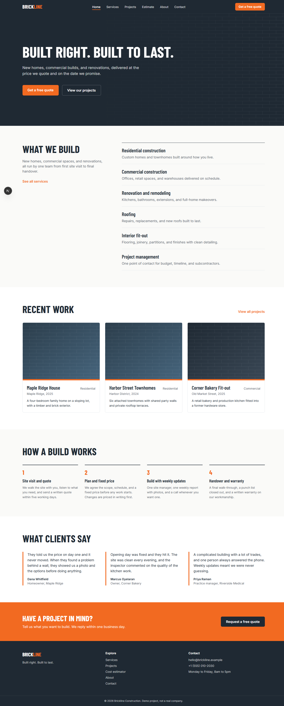
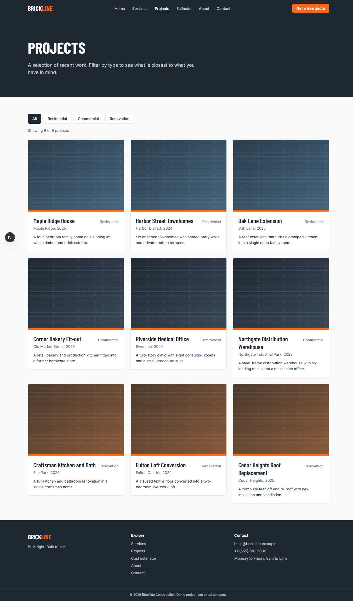
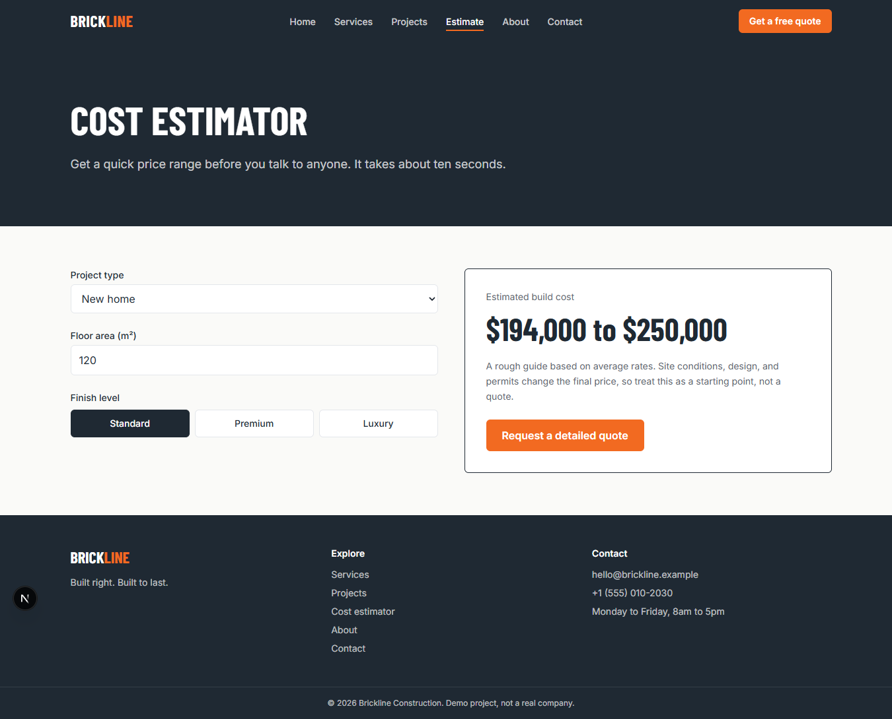

# Brickline Construction

**A fast, accessible, fully typed marketing website for a construction company, built with Next.js, TypeScript, and Tailwind CSS.**


**Repository:** https://github.com/snrmzi/Brickline-Construction

> This is a portfolio project. Brickline Construction, its projects, prices, and testimonials are fictional.



<p>
  
  
</p>

---

## Overview

Construction companies win work on trust. A visitor deciding who to call wants to see real projects, get a sense of cost, and reach a person without friction. Brickline is a complete front end for that journey:

1. **Browse** completed projects, filtered by type, with a case-study page for each one.
2. **Estimate** a rough budget in seconds, without leaving the site.
3. **Request a quote** through a form that validates input on the server and is usable with a keyboard and screen reader.

The goal of the project was to build something that looks and behaves like a production site: typed content, statically generated pages, real form handling, accessibility, and SEO basics, rather than a single landing page.

## Features

**Content and navigation**
- Home page with hero, services, featured projects, process, testimonials, and call to action
- Services page covering residential, commercial, renovation, roofing, interior fit-out, and project management
- About page with company story, key figures, working principles, and credentials
- Responsive navigation with a mobile menu and active-page highlighting

**Project gallery**
- Nine sample projects, filterable by Residential, Commercial, and Renovation
- Live result count announced to screen readers when a filter changes
- Statically generated case-study page for every project: challenge, result, scope of work, and a "title block" fact sheet styled after a construction drawing
- Previous and next project navigation

**Cost estimator**
- Estimates a price range from project type, floor area, and finish level
- Validates input and explains what is wrong instead of showing a broken number
- Links directly to the quote form

**Quote request form**
- Server-side validation with Zod, so it cannot be bypassed from the browser
- Field-level error messages tied to inputs with `aria-describedby`
- Hidden honeypot field to filter basic spam bots
- Pending state on the submit button and a clear confirmation message

**Quality and SEO**
- Per-page titles and descriptions, with a shared title template
- Generated `sitemap.xml` (including every project page) and `robots.txt`
- Semantic HTML landmarks, visible keyboard focus, `prefers-reduced-motion` support
- Mobile-first, responsive layout

## Tech stack

| Area | Technology | Why |
|---|---|---|
| Framework | Next.js 16 (App Router) | Static generation, file-based routing, server actions, built-in metadata and sitemap support |
| UI | React 19 | Server components by default, client components only where interaction is needed |
| Language | TypeScript (strict) | Typed content and props catch mistakes before they reach the browser |
| Styling | Tailwind CSS 4 | Design tokens defined once in CSS, utility classes in markup |
| Validation | Zod | One schema validates and types the form data on the server |
| Fonts | `next/font` (Barlow Condensed, Inter) | Self-hosted at build time, no layout shift or extra requests |
| Hosting | Vercel | Git-based deploys with a preview for every push |

## Architecture and key decisions

**Typed content layer.** Services, projects, and testimonials live in `data/` as typed arrays. Pages stay thin, and adding a project is a single object that automatically gets a gallery card, a case-study page, and a sitemap entry.

**Static generation for project pages.** `app/projects/[slug]` uses `generateStaticParams`, so all nine case studies are built at deploy time. They load instantly and are fully crawlable. Unknown slugs return a real 404.

**Server action for the quote form.** The form posts to a server action (`app/contact/actions.ts`) that validates with Zod and returns field-level errors plus the submitted values, so users never lose what they typed. A TODO marks where persistence (database and email) plugs in.

**Server components first.** Only the pieces that need state are client components: the navbar menu, the project filter, the estimator, and the quote form. Everything else renders on the server.

**Design system through tokens.** Colors and fonts are declared once with Tailwind's `@theme` (charcoal, safety orange, warm off-white), so the whole site can be re-themed from `app/globals.css`.

**No stock photography.** Project covers use a CSS brick-bond pattern. It keeps pages light, avoids licensing issues, and gives the brand a recognizable motif. Swapping in real photos later means replacing one component.

### Estimator logic

```
estimate = floor area × base rate (by project type) × finish multiplier
range    = estimate × 0.90  to  estimate × 1.15, rounded to a sensible step
```

Rates and multipliers are demo values defined at the top of `components/estimator/CostEstimator.tsx`.

## Project structure

```
app/
  page.tsx                  Home
  services/                 Services page
  projects/                 Gallery and [slug] case-study pages
  estimate/                 Cost estimator page
  about/                    About page
  contact/                  Quote page and server action (actions.ts)
  sitemap.ts, robots.ts     SEO routes
components/
  layout/                   Navbar, Footer
  sections/                 Home page sections
  projects/                 ProjectCard, ProjectCover, ProjectGallery
  forms/                    QuoteForm
  estimator/                CostEstimator
  ui/                       Container, PageHeader
data/                       Typed content (services, projects, testimonials)
lib/                        Shared types and constants (quote, site, patterns)
```

## Getting started

**Prerequisites:** Node.js 20 or newer and npm.

```bash
git clone https://github.com/snrmzi/Brickline-Construction.git
cd Brickline-Construction
npm install
npm run dev
```

Open http://localhost:3000.

| Script | Purpose |
|---|---|
| `npm run dev` | Start the development server |
| `npm run build` | Create a production build |
| `npm run start` | Serve the production build |
| `npm run lint` | Run ESLint |

## Accessibility

- Semantic landmarks, one `h1` per page, and a logical heading order
- All form fields have visible labels; errors are linked to their fields and styled with more than color
- Filter buttons expose their state with `aria-pressed`; result counts use `aria-live`
- Visible `:focus-visible` outlines on every interactive element
- Animations respect `prefers-reduced-motion`
- Decorative elements are hidden from assistive technology

## Performance

Measured with Lighthouse on the production deployment:

| Page | Performance | Accessibility | Best Practices | SEO |
|---|---|---|---|---|
| Home | _add_ | _add_ | _add_ | _add_ |
| Projects | _add_ | _add_ | _add_ | _add_ |
| Project detail | _add_ | _add_ | _add_ | _add_ |

## Challenges and lessons learned

- **Cache Components and time-dependent values.** Next.js 16's prerendering rejects values that change between renders, such as `new Date()` in the footer. I resolved it by caching the footer with `"use cache"`, which taught me how the framework separates static, cached, and request-time work.
- **Server action file restrictions.** A `"use server"` file can only export async functions, so exporting shared option lists and types from it broke the form at build time. Moving constants and types into `lib/quote.ts` fixed it and gave client and server a single source of truth.
- **Case-sensitive file systems.** Mismatched filename casing (`navbar.tsx` versus `Navbar`) works on Windows but fails on Linux build servers. Standardizing on PascalCase component files and matching imports exactly avoided a failed deployment.
- **Form UX under server validation.** Returning submitted values alongside errors, and wiring errors to inputs for assistive technology, made a server-validated form feel as responsive as a client-validated one.

## License

Released under the MIT License. See `LICENSE` for details.
